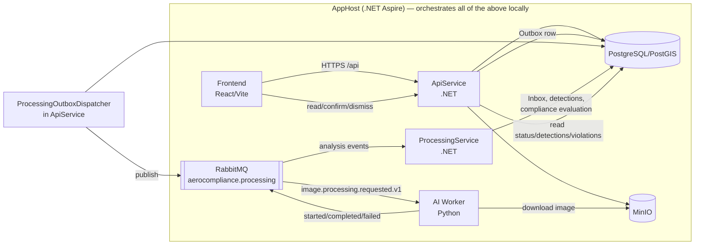
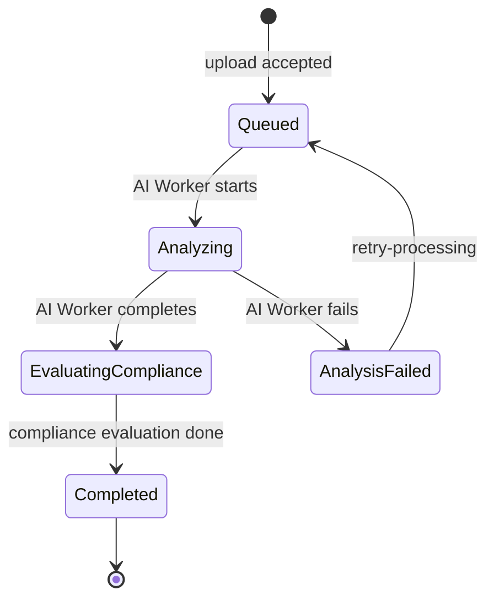

# AeroCompliance

AeroCompliance is a municipal drone-compliance platform. It lets a municipality:

1. Manage municipalities and their geographic planning data (zones, blocks, parcels, roads, zoning rules).
2. Manage drone flights and missions.
3. Accept aerial imagery captured during those flights.
4. Store that imagery in MinIO (S3-compatible object storage).
5. Process images asynchronously over RabbitMQ.
6. Run AI detection in a separate Python **AI Worker**.
7. Evaluate geographic compliance in .NET using PostgreSQL/PostGIS.
8. Create **candidate violations** from detections that intersect protected geometry (roads, parcels).
9. Let inspectors/reviewers **confirm or dismiss** those candidates.
10. Keep a full history and audit trail of every decision.

**AI Detection → Candidate Violation → Confirmed/Dismissed Violation.** The AI Worker only proposes
detections; a `Detection` becomes a `Violation` only when it geometrically intersects a road or falls
outside a parcel boundary, and that `Violation` starts in status `under_review`. **The AI never makes
the final legal decision** — only a human with the `ReviewViolations` policy (Admin, Reviewer,
Inspector) can move it to `confirmed_under_notification` or `dismissed`.

## 1. Current project status

### Implemented

- JWT login/refresh/logout with refresh-token rotation and hashed storage ([AuthController](src/AeroCompliance.ApiService/Controllers/AuthController.cs)).
- Role-based authorization via named policies (six roles, eight policies).
- Municipality (tenant) scoping on every business query; cross-tenant reads return `404`.
- Municipalities, Users, Zones, Blocks, Parcels, Roads, Zoning Rules CRUD APIs.
- Flights, missions, and image upload (multipart, streamed SHA-256, magic-byte validation).
- Automatic capture-metadata extraction on upload (Phase 5): server-side JPEG EXIF/GPS extraction and
  a GeoTIFF raster-metadata foundation, so `capturedAt`/`latitude`/`longitude` are optional form
  fields rather than required manual input. See "Automatic metadata extraction" in [§6](#6-ai-modes).
- MinIO object storage for image bytes, with upload compensation (deletes the object if the DB write fails).
- RabbitMQ-based asynchronous image processing (Outbox in the API, Inbox in the ProcessingService).
- Python AI Worker in **mock mode**, fully wired end to end (upload → detection → violation).
- PostGIS-based compliance evaluation for road encroachment and parcel encroachment.
- Violation confirm/dismiss review workflow with status history.
- Dashboard summary endpoint (counts by violation status, recent violations).
- Audit log (tenant-scoped) covering every mutating action across all controllers.
- Integrated React/Vite/TypeScript frontend (Dashboard, Violations, Flights, Detections, GIS, Administration, Audit, Settings, Login), built and served by AppHost via Docker + nginx.
- Multi-file upload UX with per-file state/progress, client-side EXIF preview, controlled-concurrency
  uploads, per-file retry, and a Leaflet map (image locations, AI detections, and — on the violation
  detail page — the reviewed detection styled by status) (Phase 5).
- A reusable draw/import/advanced `GeometryEditor` (Leaflet + geoman) for Zone/Block/Parcel/Road and
  flight-planned-area forms, replacing raw GeoJSON text as the primary input — see "Drawing and
  editing boundaries in the frontend" in [§7](#7-crs-and-gis-rules).
- Unit tests (16 test methods) and integration tests (13 test methods) — 29 `[Fact]`/`[Theory]` methods total.

### Implemented in mock/development mode

- **AI detection** — `AI_MODE=mock` is the default and only fully working mode; it generates a
  deterministic `building` detection polygon around the image's capture coordinates (or none/failure
  on request). See [§7](#7-ai-modes).
- **Dev user seeding** — one user per role is auto-created on API startup in `Development`
  (`DevUserSeeder`), all sharing the password `ChangeMe123!`. Never runs outside `Development`.
- **JWT signing key** — falls back to a hardcoded development key when unset, but only inside
  `Development`; startup throws outside it.
- **File-type validation for uploads** — PNG/JPEG are only accepted in `Development` (to exercise the
  mock pipeline); GeoTIFF is the only format the code path treats as production-real, and even then no
  raster CRS/affine-transform reading is implemented yet (see below).

### Not yet implemented or not production-ready

- **YOLO / real-model inference** — `YoloModelRunner.analyze()` unconditionally raises
  `"YOLO georeferencing is not enabled in this phase; use AI_MODE=mock."` The class loads an
  Ultralytics `YOLO(model_path)` model but never runs inference or georeferences pixel output. **No
  real model has been verified or handed off.**
- **Pixel → geographic coordinate conversion** for raster imagery (`geospatial.py` only contains a
  guard that raises if CRS/affine transform are missing — no actual conversion is implemented).
- **Zoning-rule engine** — `ZoningRule` has full CRUD and a `validate` action, but the compliance
  evaluator (`AnalysisResultConsumer.Evaluate`) does not read zoning rules at all; it only checks
  raw road/parcel geometry intersection. `RuleId` on a `Violation` is always `null` today.
- **Notifications** — the `notifications` table and `Notification` entity exist; no controller, no
  delivery logic.
- **Police alerts** — the `police_alerts` table and `PoliceAlert` entity exist; no controller, no
  dispatch logic.
- **Orthomosaic processing** — the `Orthomosaic` entity and its detections relation exist in the
  schema; nothing populates or processes orthomosaics yet.
- **Official municipality GIS import** — no import pipeline; zones/blocks/parcels/roads are created
  through the CRUD API only (or the smoke-test script).
- **`AeroCompliance.IngestionService`** — legacy/disabled. It is **not** referenced by
  `AppHost.cs` and does not run as part of a normal `dotnet run`. Its one endpoint is additionally
  gated behind `LegacyIngestion:Enabled` (off by default). `FlightImagesController` under
  `AeroCompliance.ApiService` is the sole authoritative upload path.
- **Fine-grained permissions** — the `permissions`/`role_permissions` tables exist but authorization is
  role-based only (`[Authorize(Roles = ...)]` / policy `RequireRole`), not permission-based.
- **Production deployment** — no production compose/Kubernetes manifests, no secret-store
  integration, no HTTPS/CORS hardening beyond ASP.NET Core defaults.
- **Automated test coverage of GIS/AI/violation flows** — the 29 existing tests cover authentication,
  authorization policy shape, and the current-user endpoint; there is no automated test for the
  upload → detection → violation pipeline (the `scripts/phase4_smoke.py` script does that manually).

## 2. Architecture



Boundaries:

- **Frontend** calls only the .NET **ApiService** — never MinIO or RabbitMQ directly.
- **ApiService** owns every public business operation (auth, GIS, flights, uploads, violations,
  dashboard, audit) and is the only service that runs EF Core migrations.
- **MinIO** stores raw file bytes only; it has no knowledge of business data.
- **PostgreSQL/PostGIS** is the single source of truth for business and geographic data.
- **RabbitMQ** transports asynchronous events between ApiService, the AI Worker, and ProcessingService
  — it never carries image bytes, only metadata and object keys.
- **AI Worker** (Python) downloads the image bytes from MinIO, verifies the hash, runs inference (mock
  or YOLO), and publishes structured detection results — it never touches the database.
- **ProcessingService** (.NET) is the only consumer of AI results; it persists detections and runs the
  PostGIS-based compliance match that creates candidate violations.
- **Human reviewers** (Inspector/Reviewer/Admin) make the final violation decision through the API —
  the pipeline never auto-confirms or auto-dismisses a violation.

## 3. Repository structure

```text
DroneProject/
├── AeroCompliance.slnx              Solution file
├── dotnet-tools.json                Pins the dotnet-ef local tool
├── scripts/
│   └── phase4_smoke.py              Development smoke-test script (see §22)
├── docs/
│   └── architecture/                Design notes (Phase 1 architecture doc)
├── tests/
│   ├── AeroCompliance.UnitTests          xUnit unit tests (no external deps)
│   └── AeroCompliance.IntegrationTests   xUnit + Testcontainers integration tests
└── src/
    ├── AeroCompliance.AppHost            .NET Aspire orchestrator — runnable .NET service
    ├── AeroCompliance.ApiService         Main Web API — runnable .NET service
    ├── AeroCompliance.ProcessingService  AI-result consumer — runnable .NET service (worker, no HTTP)
    ├── AeroCompliance.IngestionService   Legacy upload skeleton — runnable but NOT started by AppHost
    ├── AeroCompliance.AiWorker           Python inference service — container built by AppHost
    ├── AeroCompliance.Frontend           React/Vite/TS SPA — container (nginx) built by AppHost
    ├── AeroCompliance.Domain             Entities + enums — class library
    ├── AeroCompliance.Infrastructure     EF Core DbContext, PostGIS config, migrations, MinIO client — class library
    ├── AeroCompliance.Contracts          Shared DTOs + RabbitMQ message contracts — class library
    └── AeroCompliance.ServiceDefaults    Shared OpenTelemetry/health/resilience wiring — class library
```

| Project | Role |
|---|---|
| `AeroCompliance.AppHost` | Runnable .NET service — Aspire orchestrator; the only thing you `dotnet run` |
| `AeroCompliance.ApiService` | Runnable .NET service — public REST API, Swagger, migrations owner |
| `AeroCompliance.ProcessingService` | Runnable .NET service — background worker, consumes AI results, no HTTP surface |
| `AeroCompliance.IngestionService` | Runnable .NET service, **legacy/disabled** — not wired into AppHost, endpoint gated off by default |
| `AeroCompliance.AiWorker` | Python service — built into a Docker image (`aerocompliance-ai-worker`) and run as an AppHost container resource |
| `AeroCompliance.Frontend` | Frontend service — built into a Docker image (`aerocompliance-frontend`, nginx) and run as an AppHost container resource |
| `AeroCompliance.Domain` | Class library — entities (`Flight`, `Image`, `Violation`, …) and enums |
| `AeroCompliance.Infrastructure` | Class library — `AeroComplianceDbContext`, EF configurations, migrations, MinIO client |
| `AeroCompliance.Contracts` | Class library — DTOs and RabbitMQ message records shared across services |
| `AeroCompliance.ServiceDefaults` | Class library — shared Aspire service-defaults extension (`AddServiceDefaults`) |
| `tests/AeroCompliance.UnitTests` | Test project — xUnit, no external dependency |
| `tests/AeroCompliance.IntegrationTests` | Test project — xUnit + Testcontainers (needs Docker) |
| `scripts/phase4_smoke.py` | Development script — manual end-to-end pipeline check |
| `docs/architecture/` | Documentation — Phase 1 design notes |

**Upload path**: `AeroCompliance.IngestionService` is legacy. It is not referenced from
[AppHost.cs](src/AeroCompliance.AppHost/AppHost.cs) and its only route is gated behind
`LegacyIngestion:Enabled` (default off). The authoritative, currently-used upload path is
`POST /api/flights/{flightId}/images` in `AeroCompliance.ApiService`
([FlightImagesController.cs](src/AeroCompliance.ApiService/Controllers/FlightImagesController.cs)).

**Frontend**: fully integrated. `AeroCompliance.Frontend` is a real React 19 + Vite + TypeScript SPA
with pages for Dashboard, Violations, Flights, GIS, Detections, Administration, Audit, Settings, and
Analytics, Reports, and Login. AppHost builds it via its own [Dockerfile](src/AeroCompliance.Frontend/Dockerfile)
(multi-stage Node build → nginx) and runs it as the `frontend` container resource, proxying `/api/*` to the
`apiservice` endpoint (see [nginx.conf.template](src/AeroCompliance.Frontend/nginx.conf.template)).

## 4. Technology stack

- **.NET 10**, **ASP.NET Core**, **.NET Aspire** (orchestration + service defaults)
- **EF Core** (Npgsql provider) + **NetTopologySuite** for PostGIS geometry mapping
- **PostgreSQL 16 + PostGIS 3.4** (`postgis/postgis:16-3.4` image)
- **RabbitMQ** (management plugin enabled)
- **MinIO** (S3-compatible object storage, generic container — no native Aspire component)
- **Python 3** AI Worker: Flask (health/ready endpoints), `pika` (RabbitMQ client), `minio` (client
  SDK); `ultralytics` (YOLO) and `rasterio`/`shapely` (GeoTIFF georeferencing, Phase 5) are
  **optional** dependencies installed only via `requirements-yolo.txt`
- **`MetadataExtractor`** (.NET, pure-managed) — server-side JPEG EXIF/GPS extraction (Phase 5,
  `AeroCompliance.ApiService`)
- **React 19 + Vite 7 + TypeScript**, `react-router-dom`, `axios`, `lucide-react`, `leaflet` (maps),
  `@geoman-io/leaflet-geoman-free` (draw/edit boundaries), `@turf/*` (`kinks`, `area`,
  `boolean-within`, `helpers` — geometry validation/normalization), `exifr` (client-side EXIF preview
  only, Phase 5) (frontend)
- **OpenTelemetry** via Aspire `ServiceDefaults` (traces/metrics/health checks)
- **Swagger / OpenAPI** (ApiService, Development only) with a Bearer auth scheme wired in
- **Docker** — required for Postgres, RabbitMQ, MinIO, the AI Worker container, and the frontend
  container; also required (Docker Desktop / another engine) for the integration test suite
  (Testcontainers)

TensorFlow is **not** used anywhere in this codebase; the only ML dependency referenced is
`ultralytics` (YOLO), and only in the not-yet-functional YOLO code path.

## 5. End-to-end processing flow

1. An authenticated user (Admin, MunicipalityManager, or DroneOperator) creates a flight
   (`POST /api/flights`) and, if needed, a mission (`POST /api/flights/{id}/missions`).
2. A user with `ManageFlights` uploads an image: `POST /api/flights/{flightId}/images` (multipart).
3. The API checks authorization/tenant ownership, file size (≤ 250 MB by default), extension/MIME
   combination, and the file's magic-byte signature.
4. The API streams the file to a temp path while computing its SHA-256 hash.
5. The API uploads the file to MinIO under
   `{municipalityId:N}/{flightId:N}/{yyyy/MM/dd}/{imageId:N}{ext}`.
6. In the same database transaction, the API inserts the `Image` row (`ProcessingStatus = Queued`) and
   an `OutboxMessage` row carrying an `ImageProcessingRequested` event, plus an audit row.
7. A background service (`ProcessingOutboxDispatcher`, hosted inside ApiService) polls
   `outbox_messages` every second and publishes unpublished rows to RabbitMQ
   (`image.processing.requested.v1`).
8. The AI Worker consumes the message, downloads the image from MinIO, and re-verifies the SHA-256.
9. The Worker runs `MockModelRunner` (default) or `YoloModelRunner` (not functional yet — see §7).
10. The Worker publishes `image.analysis.started.v1`, then `image.analysis.completed.v1` (with
    detections) or `image.analysis.failed.v1`.
11. `AeroCompliance.ProcessingService` consumes these events idempotently (see below) via
    `AnalysisResultConsumer`.
12. It records/updates an `ImageAnalysis` row and inserts `Detection` rows for each item.
13. For every detection whose class is `building` or `violation`, it runs a PostGIS query (metric CRS
    `EPSG:32636`) to check road intersection, then parcel-boundary encroachment.
14. If a road or parcel match is found, it inserts a `ComplianceEvaluation` and a candidate `Violation`
    in status `under_review`.
15. The frontend/Swagger client polls `GET /api/images/{id}/processing-status`, and reads
    `GET /api/detections` and `GET /api/violations` once processing completes.
16. An Inspector/Reviewer/Admin calls `POST /api/violations/{id}/confirm` or `.../dismiss`.
17. The violation's status, `ViolationStatusHistory`, the dashboard summary, and the audit log all
    reflect the decision.

**Failure and retry**: on any failure the Worker publishes `image.analysis.failed.v1` with a
`retryable` flag (`false` only for `MALFORMED_REQUEST`/`MISSING_CAPTURE_COORDINATES`); the image moves
to `AnalysisFailed`. `POST /api/images/{id}/retry-processing` re-queues an image that is
`AnalysisFailed` or `ComplianceFailed`, incrementing `AttemptCount` and issuing a new `RequestId`
chained to the prior one via `causationId`.

**Why RabbitMQ can deliver more than once, and how duplicates are prevented**: RabbitMQ consumer acks
can be lost or redelivered after a crash, so the same event can arrive twice.
- The **Outbox** (in ApiService) only marks a row `PublishedAt` after a confirmed publish, so a crash
  before confirmation republishes safely rather than losing the event.
- The **Inbox** (in ProcessingService — `inbox_messages`, unique on `(event_id, consumer)`) makes
  `HandleAsync` a no-op for an event it has already recorded for that consumer.
- **Deterministic IDs**: the mock model derives each `detectionId` via `uuid5(requestId, "detection:N")`
  so a reprocessed request yields the same detection ID; `Detection` is unique on
  `(image_analysis_id, external_detection_id)` and `ComplianceEvaluation` is unique on
  `(detection_id, evaluation_type)`, so duplicate detections/violations cannot be inserted twice for
  the same request.

## 6. AI modes

### AI Worker dependency profiles

The AI Worker's Docker image can be built with one of three dependency profiles (selected by the
`AI_REQUIREMENTS` build arg — see the AI Worker README for exact commands). This is a separate axis
from `AI_MODE` (mock vs. yolo): the profile controls which *libraries* are installed in the image;
`AI_MODE` controls which inference path actually runs at *runtime*.

| Profile (`AI_REQUIREMENTS=`) | Adds | Used for |
|---|---|---|
| `requirements.txt` (core) | pika, minio, flask only | Smallest/fastest build; mock detection only, no GeoTIFF metadata |
| `requirements-geospatial.txt` | core + `rasterio`, `shapely`, `pyproj` | **AppHost's default** — mock detection *and* real GeoTIFF metadata extraction |
| `requirements-yolo.txt` | geospatial + `ultralytics` (pulls PyTorch) | Real YOLO inference once a `.pt` model is supplied |

**AppHost builds the `geospatial` profile by default** (`AppHost.cs`:
`.WithBuildArg("AI_REQUIREMENTS", "requirements-geospatial.txt")` on the `aiworker` resource), so a
normal `dotnet run` gets working GeoTIFF metadata extraction out of the box — `AI_MODE` still
defaults to `mock`, so no model or PyTorch/CUDA is required. To build the smaller core-only image
instead (e.g. for a faster iteration loop when GeoTIFF isn't needed), change that one line to
`"requirements.txt"`. To move toward real YOLO later, change it to `"requirements-yolo.txt"` and see
[§20](#20-real-model-handoff). Verified in this workspace: the core and geospatial images both build
and run correctly (see the AI Worker README for the exact commands and what was checked); the yolo
profile builds (~10 GB, ~15 minutes, dominated by PyTorch/CUDA downloads) but has not been exercised
with a real model.

### `AI_MODE=mock` (current default)

- Set by `AppHost.cs` as the AI Worker container's default environment (`AI_MODE=mock`).
- Requires no `.pt` model file.
- Lets the entire platform — upload, queueing, detection, compliance evaluation, violation review — be
  exercised without a trained model.
- Supported scenarios (`mockScenario` form field, accepted only when `ASPNETCORE_ENVIRONMENT` is
  `Development`, on `POST /api/flights/{id}/images`), per
  [model.py](src/AeroCompliance.AiWorker/aerocompliance_ai/model.py):
  - `none` — returns zero detections.
  - `failure` — raises a deterministic `MOCK_FAILURE` (`retryable: true`), driving the failure/retry path.
  - anything else, including `building`, `road_encroachment`, `parcel_encroachment`, or blank —
    produces **one `building` detection** as a small square polygon centered on the image's captured
    `latitude`/`longitude`. **The scenario name itself does not change the AI output beyond
    `none`/`failure`** — whether the resulting violation is classified `road_encroachment` or
    `parcel_encroachment` is decided entirely by which real GIS geometry (road vs. parcel) the
    generated polygon actually intersects in the database, evaluated by `ProcessingService`.
- Coordinates → polygon: a fixed `±0.00008°` box around `(longitude, latitude)`, in `EPSG:4326`, is
  used as the detection geometry — deterministic per request.
- Failure/retry: the `failure` scenario always fails with an explicit, retryable error, which
  `scripts/phase4_smoke.py` exercises via `retry-processing`.

### `AI_MODE=yolo`

- Configuration: `AI_MODEL_PATH` (default `/models/model.pt`), `AI_CONFIDENCE_THRESHOLD` (default
  `0.50`), `AI_MODEL_NAME` / `AI_MODEL_VERSION` (labels only, not validated against the model file).
- Optional dependency: `ultralytics` is installed only via the `yolo` profile
  ([requirements-yolo.txt](src/AeroCompliance.AiWorker/requirements-yolo.txt), which itself layers on
  `requirements-geospatial.txt`). The Worker's Dockerfile must be built with
  `--build-arg AI_REQUIREMENTS=requirements-yolo.txt` for YOLO mode to even import successfully.
- Expected input: a georeferenced GeoTIFF (`.tif`/`.tiff`, MIME `image/tiff` or `image/geotiff`) —
  this is the **only** format `FlightImagesController.ValidFile` accepts outside `Development`.
- Raster CRS + affine transform: **required**. [geospatial.py](src/AeroCompliance.AiWorker/aerocompliance_ai/geospatial.py)
  (Phase 5) reads both via `rasterio` (`extract_raster_metadata`) and converts pixel-space mask/box
  coordinates into `EPSG:4326` rings (`pixel_to_raster` → `raster_to_wgs84` →
  `build_multipolygon_geojson`, the last using `shapely` to validate/repair a part rather than drop a
  whole multi-part detection). A raster with no CRS, only an identity transform, or non-finite
  transform/bounds raises a specific `MISSING_GEOREFERENCING`/`INVALID_GEOREFERENCING` code rather
  than being silently accepted.
- `rasterio`/`shapely`/`pyproj` come from the `geospatial` profile (which the `yolo` profile also
  includes) — see [the AI Worker README](src/AeroCompliance.AiWorker/README.md). AppHost already
  builds the `geospatial` profile by default, so `rasterio` is present; only `ultralytics`/PyTorch
  (the `yolo` profile on top) is still missing until a teammate deliberately switches to it.
- Output CRS: `EPSG:4326`, matching the rest of the system (`ImageAnalysisCompleted.OutputCrs` is hardcoded to `"EPSG:4326"` in `main.py` regardless of mode).
- **Current real behavior**: `YoloModelRunner` lazily imports `ultralytics` and loads `AI_MODEL_PATH`
  only when `analyze()` actually runs; it requires the raster/YOLO-capable build (`rasterio`
  installed) and a genuinely georeferenced input, runs the model, and converts each detection's
  segmentation mask (or bounding box, if the model has no mask head) into `EPSG:4326` via the
  utilities above. **This is structurally complete but functionally unverified** — no `.pt` model or
  representative georeferenced GeoTIFF has been available in this workspace to run it end to end.
- **No real, verified model has been handed off or validated in this workspace.** The placeholder
  `models/` directory and `AI_MODEL_PATH` wiring exist so a teammate can drop in a model later, but
  nothing here should be described as production-ready.

### Automatic metadata extraction (Phase 5)

Normal users no longer have to manually type technical capture metadata:

- **JPEG** — `AeroCompliance.ApiService` re-extracts EXIF/GPS from the *uploaded bytes* server-side
  (never trusts a client preview) via
  [ImageExifExtractor.cs](src/AeroCompliance.ApiService/Services/ImageExifExtractor.cs) (the
  `MetadataExtractor` NuGet package): capture timestamp, GPS latitude/longitude, altitude, image
  direction (heading), and camera make/model, when present. The frontend also reads EXIF client-side
  ([exifPreview.ts](src/AeroCompliance.Frontend/src/lib/exifPreview.ts), via `exifr`) purely for an
  immediate preview — it is never what the system trusts.
- **GeoTIFF/TIFF** — raster CRS, width, height, and affine transform are read by the **AI Worker**
  via `rasterio` (present by default — AppHost builds the `geospatial` profile, see above) and
  persisted onto the `Image` row (`SourceRasterCrs`/`RasterWidth`/`RasterHeight`/`AffineTransform`)
  and `OutputCrs` onto `ImageAnalysis` once analysis completes. **Verified through the full running
  system** (real HTTP upload → MinIO → Outbox → RabbitMQ → AI Worker → `ProcessingService` →
  PostgreSQL): a genuinely georeferenced GeoTIFF's CRS/width/height/affine transform are correctly
  persisted; a non-georeferenced TIFF completes processing safely with those four fields left `null`
  rather than failing or inventing values.
- **EXIF location and GeoTIFF georeferencing are not the same kind of fact, and are never presented
  as equivalent.** A JPEG's EXIF GPS tag is a single point recorded by the camera/drone at the moment
  of capture — it locates *the camera*, approximately, and says nothing about individual pixels. A
  GeoTIFF's CRS + affine transform georeferences *every pixel* of the raster precisely enough to
  convert a detection mask into map coordinates. This is why `LocationSource` distinguishes
  `"GeoTiff"` from `"Exif"` rather than treating them as interchangeable, and why only a GeoTIFF (not
  a JPEG) can carry the `SourceRasterCrs`/`RasterWidth`/`RasterHeight`/`AffineTransform` fields at all.
- **PNG or images with no geographic metadata** (Development mock mode only) — a supplied
  latitude/longitude is used as given; with none supplied, the location is recorded as `"Missing"`
  rather than defaulting to any municipality's coordinates, and `MetadataRequiresReview` is set so a
  reviewer knows to confirm/correct it (e.g. via the frontend's map picker). Verified directly against
  the database: no image row's location is ever silently invented — every row with
  `location_source = 'Missing'` has `latitude`/`longitude` genuinely `NULL`.
- **Precedence** (`FlightImagesController.ResolveMetadata` at upload time; `ProcessingService`
  persisting raster fields once the AI Worker reports them): valid GeoTIFF georeferencing (discovered
  only *after* upload, asynchronously, by the AI Worker — not resolvable inside the upload request
  itself) is the authoritative pixel-level source and is stored separately once available; otherwise
  valid server-extracted EXIF locates the image approximately; otherwise an explicit user/map-picked
  value (`ImageUploadForm.OverrideLocation=true` to force this ahead of EXIF); otherwise the location
  stays `"Missing"` and is flagged for review. The same precedence applies to capture time (EXIF
  `DateTimeOriginal` vs. a supplied `capturedAt`; missing falls back to upload time). Client-supplied
  values are never allowed to silently override server-extracted ones by default — only an explicit
  override does that, and it is recorded (`LocationSource="UserProvided"`), not hidden.
- **A note on pre-Phase-5 data**: images uploaded before the `Phase5ImageMetadataProvenance` migration
  existed show `LocationSource="Missing"` even if they have a real latitude/longitude — the migration
  cannot retroactively know *how* an old coordinate was obtained, so it labels old rows with the
  conservative/unknown value rather than guessing. This is a labeling artifact of the backfill, not
  evidence of lost or invented data.
- **Provenance fields** on `Image`: `LocationSource`, `CaptureTimeSource` (`"GeoTiff"` | `"Exif"` |
  `"UserProvided"` | `"Missing"`), and `MetadataRequiresReview` (bool) — added by the
  `Phase5ImageMetadataProvenance` migration. `GET /api/images/{id}` and the upload receipt both
  return them.
- **Validation**: latitude/longitude are range- and finiteness-checked (rejecting NaN/±Infinity)
  both from form binding and from EXIF; an implausible EXIF altitude (outside roughly -500m to
  12,000m) or heading (outside 0–360°) is discarded rather than trusted; EXIF's `DateTimeOriginal` has
  no reliable timezone in the vast majority of cameras/drones, so it is treated as UTC and tagged
  `"Exif"` rather than pretending a timezone is known. No parser exception is ever returned to the
  caller — a corrupt/absent EXIF segment just yields fewer extracted fields.

## 7. CRS and GIS rules

- **`EPSG:4326`** (WGS84 longitude/latitude) is the canonical storage CRS for every geometry column
  (`zones.geom`, `roads.geom`, `parcels.geom`, `images.geom`, `detections.geom`, `violations.geom`,
  …), for RabbitMQ event payloads, and for every GeoJSON the API reads/writes. **Longitude comes before
  latitude** in GeoJSON coordinate pairs (`[lon, lat]`), which is easy to get backwards.
- **`EPSG:32636`** (WGS84 / UTM zone 36N — covers the Ramallah/Palestine MVP area) is used only for
  metre/area math: `AnalysisResultConsumer.Evaluate` transforms geometries into `32636` with
  `ST_Transform` before computing `ST_Area`/`ST_Intersection`/`ST_Difference`, then stores the result
  back as a plain numeric (`measured_value`, `exceedance_area_m2`) tagged with `metric_crs = 32636`.
- **Pixel coordinates are not map coordinates.** `images` has `source_raster_crs`, `raster_width`,
  `raster_height`, and `affine_transform` (jsonb) columns reserved for this, but nothing populates them
  yet, and `geospatial.require_georeferencing` exists specifically to stop pixel output from being
  treated as geographic output before that conversion is implemented.
- A source shapefile's `.prj` file must be respected when importing external GIS data — there is no
  automated import pipeline in this codebase yet, so this is a rule for whoever builds that importer,
  not a check the system currently performs.
- Any local GIS data present in a developer's environment (zones/roads/parcels created through the API
  or `scripts/phase4_smoke.py`) is **demo/import data**, not official municipal data, unless a specific
  import has been confirmed with the municipality.

**Currently implemented compliance logic** (`AnalysisResultConsumer.Evaluate`, road/parcel only):

1. Only detections classified `building` or `violation` are evaluated.
2. **Road intersection**: pick the road (within the same municipality) with the largest intersection
   area against the detection polygon (both transformed to `32636`); if any road intersects, create a
   `road_encroachment` violation with `measured_value` = intersection area.
3. **Parcel encroachment**: only checked if no road matched. Pick the parcel with the largest
   intersection against the detection; if the area of the detection *outside* that parcel exceeds
   `0.01 m²`, create a `parcel_encroachment` violation with `measured_value` = the outside area.
4. **What is still simplified / not implemented**: no zoning-rule evaluation (`RuleId` is always
   `null`), no setback/height/coverage-ratio checks against `zoning_rules.rule_value`, no orthomosaic
   detections, and no multi-detection aggregation per image.

### Drawing and editing boundaries in the frontend

Zones, blocks, parcels, roads, and a flight's planned area all use the same reusable
[GeometryEditor](src/AeroCompliance.Frontend/src/components/GeometryEditor.tsx) component. **There is
no raw-GeoJSON text box anywhere in the municipal frontend** — it was removed entirely (an earlier
"Advanced GeoJSON" mode existed briefly and has since been deleted), because normal municipal users
should never need to read or write GeoJSON by hand. GeoJSON remains the format used internally
between the frontend and the API; a developer or GIS specialist who needs to inspect it uses
**Swagger or the browser's developer tools**, never a screen built for end users. (Zoning Rules don't
own geometry, so they're unaffected; Detections/Violations show geometry read-only on a map and are
never edited through this component.)

- **Two input methods**: **Draw on map** (default — click points to draw a polygon, click the first
  point again to finish; built on [`@geoman-io/leaflet-geoman-free`](https://github.com/geoman-io/leaflet-geoman)
  on top of the existing plain-Leaflet setup, not react-leaflet) and **Import boundary file** (a
  `.geojson`/`.json` file — accepts a raw `Polygon`/`MultiPolygon`, a `Feature`, or a
  `FeatureCollection`; read and validated entirely in the browser, never uploaded to object storage;
  the result — "1 boundary imported" / "N boundary parts imported" / a plain-language error — is shown
  visually on the map, never as file content, and still requires clicking "Use this geometry" and then
  the form's own Save button). Both funnel through the same normalizer
  ([`src/lib/geometry.ts`](src/AeroCompliance.Frontend/src/lib/geometry.ts)), so the request body sent
  to the API is identical regardless of which method was used.
- **Map default**: with no existing or parent geometry to zoom to, the map centers on Ramallah
  (`31.9038, 35.2034`) at a city-level zoom — this is only a starting viewport. The editor always
  displays: "Drawn boundaries represent municipality-supplied data and should be verified before
  operational use" — never a claim that a user-drawn boundary is official Ramallah cadastral data.
- **Coordinate handling**: the component only ever reads/writes shapes through Leaflet's own
  `L.geoJSON()` / `layer.toGeoJSON()`, which do the `[lat,lon]` (Leaflet) vs. `[lon,lat]` (GeoJSON)
  conversion internally — nobody using the form ever sees or handles that distinction.
- **Normalization**: a `Polygon` is normalized to a single-part `MultiPolygon` (matching what every
  GIS entity's column type requires); holes and every valid part of a `MultiPolygon` are preserved;
  rings are closed automatically. A self-intersecting, empty, non-finite, out-of-range, or otherwise
  malformed polygon is **rejected with a plain-language message**, never silently repaired into
  something the user didn't actually draw — this is deliberately different from the AI Worker's
  detection-mask handling (§6), because that geometry is machine-generated and this is user-authored.
- **Parent-boundary reference**: editing a Block shows its selected Zone as a read-only dashed
  reference layer, labeled by the Zone's **number**, never its UUID (and fits the map to it); a Parcel
  shows its selected Block the same way, by block number. A small legend distinguishes the reference
  boundary from the one actually being edited. The same reference/legend pattern is reused on the read
  -only GIS record-detail map (§ "GIS list and detail screens" below).
- **Parent-boundary containment is frontend-only.** The editor warns ("The block boundary must remain
  inside the selected zone.") and blocks submission when a Block's boundary extends outside its Zone
  (or a Parcel outside its Block), computed client-side with `@turf/boolean-within`. **The backend
  does not enforce this** — `BlocksController`/`ParcelsController` only check that the parent record
  exists and belongs to the visible tenant, not that the geometry is actually contained (confirmed
  directly: a Block record geometrically far outside its Zone was accepted by the API with
  `201 Created` when tested without going through the frontend). Treat the in-browser check as a
  usability guardrail, not a data-integrity guarantee — a script or a future API client can still
  create non-contained geometry today.
- **Road geometry** is explicitly labeled as the road's *coverage/boundary area*, not a centerline —
  the `roads.geom` column is `geometry(MultiPolygon, 4326)`, so this matches what the schema actually
  stores.

### GIS list and detail screens

Zone/Block/Parcel/Road/Zoning-rule lists show meaningful columns (e.g. Blocks: block number, **Zone**
by number, approximate area, state) instead of raw UUIDs, and the "Selected record details" panel —
previously a `JSON.stringify` dump of the whole record — is a per-type, human-readable card (numbers,
names, dates, a plain-language state) plus the boundary on a map, never JSON. `BlockDto`,
`ParcelSummaryDto`/`ParcelDetailsDto`, `ZoningRuleDto`, `ViolationSummaryDto`/`ViolationDetailsDto`,
and `DetectionSummaryDto`/`DetectionDetailsDto` were all extended with small, additive
name/reference fields (e.g. `zoneNumber`, `blockNumber`, `flightMissionName`, `sourceImageFileName`,
`validatorName`) so the frontend never has to fall back to showing an id — no schema/entity/migration
change was needed, only read-side DTO projections.

The **Audit Trail** page never renders `audit_logs.before_state`/`after_state` as JSON either: a
client-side differ ([`src/lib/audit.ts`](src/AeroCompliance.Frontend/src/lib/audit.ts)) turns the two
JSON snapshots into a "Field: old → new" list (e.g. "Status: under review → confirmed under
notification"), derives a human reference for the row from the snapshot itself (a zone/road/rule/
user's own number, code, or name — never a raw id), and drops any field whose name looks like an id
or a credential/secret/token/hash. If a snapshot can't be safely read as a flat object, the row falls
back to showing only the action, entity type, actor, and timestamp — never the raw text. The **AI
Detections** and **Violation** detail pages similarly never show detection/analysis UUIDs or a raw
geometry payload — only a short support reference (e.g. "Detection ADDE8257"), human field values,
and the geometry rendered on a map.

## 8. Database model

PostgreSQL + PostGIS via EF Core migrations under
[Persistence/Migrations](src/AeroCompliance.Infrastructure/Persistence/Migrations): `InitialCreate` →
`SeedRolesAndPilotMunicipality` → `Phase3TenantScoping` → `Phase4ImageProcessingPipeline` →
`Phase5ImageMetadataProvenance` (adds `images.location_source`, `images.capture_time_source`,
`images.metadata_requires_review` — all with safe defaults, so existing rows need no backfill).

### Tenant and access control

| Table | Stores | Written by |
|---|---|---|
| `municipalities` | Tenant records (one row = one municipality) | `MunicipalitiesController` |
| `users` | Accounts, `role_id`, optional `municipality_id` (null only for Admin) | `UsersController`, `DevUserSeeder` |
| `roles` | The six fixed roles (seeded, IDs match `RoleName`) | Migration seed only |
| `permissions` / `role_permissions` | Fine-grained permission scaffolding | **Unused today** — no code reads or writes these |
| `refresh_tokens` | Hashed refresh tokens, rotation/revocation timestamps | `AuthController` |

### GIS

| Table | Stores | Written by |
|---|---|---|
| `zones` | Municipal zoning areas (`geometry(MultiPolygon,4326)`) | `ZonesController` |
| `blocks` | Sub-areas of a zone | `BlocksController` |
| `parcels` | Individual land parcels, owner name (owner-restricted read) | `ParcelsController` |
| `roads` | Road geometries, sensitivity flag | `RoadsController` |
| `zoning_rules` | Numeric rules per zone or zone type; validation flag | `ZoningRulesController` (CRUD + validate) |

### Flights and media

| Table | Stores | Written by |
|---|---|---|
| `flights` | A drone flight: operator, municipality, planned area, status | `FlightsController` |
| `flight_missions` | Sub-missions of a flight (purpose, altitude, overlap) | `FlightsController` |
| `images` | Uploaded imagery, capture metadata (+ Phase 5 provenance: `location_source`/`capture_time_source`/`metadata_requires_review`, and raster fields once a GeoTIFF has been analyzed), processing status/attempts, MinIO location | `FlightImagesController`, `ImagesController`, `ProcessingService` |
| `videos` | Video capture metadata | schema only — no controller |
| `orthomosaics` | Stitched-imagery bounds/resolution | schema only — no controller |

### AI and processing

| Table | Stores | Written by |
|---|---|---|
| `image_analyses` | One row per processing attempt (`request_id` unique), mode/model/CRS/status | `ProcessingService` |
| `detections` | AI-detected objects with geometry, confidence, class | `ProcessingService` |
| `compliance_evaluations` | The metric evaluation behind a candidate violation | `ProcessingService` |
| `outbox_messages` | Events pending publication to RabbitMQ (ApiService side) | `FlightImagesController`, `ImagesController` → dispatched by `ProcessingOutboxDispatcher` |
| `inbox_messages` | Dedup ledger of consumed events, unique on `(event_id, consumer)` | `ProcessingService` |

### Violations and operations

| Table | Stores | Written by |
|---|---|---|
| `violation_statuses` | The seven fixed status codes/labels (see §10) | Migration seed only |
| `violations` | A candidate/decided violation, links to detection/parcel/road/rule | `ProcessingService` (create), `ViolationsController` (confirm/dismiss) |
| `violation_status_history` | Every status change with actor and notes | `ProcessingService`, `ViolationsController` |
| `reports` | PDF report metadata/sign-off | schema only — no controller |
| `notifications` | Notification delivery records | schema only — no controller |
| `police_alerts` | Police-alert dispatch records | schema only — no controller |
| `audit_logs` | Actor, action, entity, before/after JSON, municipality, IP | `AuditService`, called from every mutating controller and `ProcessingService` |

Key constraints/indexes worth knowing: unique `(municipality_id, zone_number)` /
`(zone_id, block_number)` / `(block_id, parcel_number)` / `(municipality_id, road_code)` per tenant;
`gist` indexes on every geometry column; `images.geom` is a **stored, database-computed** column
(`GENERATED ALWAYS AS (ST_SetSRID(ST_MakePoint(longitude, latitude), 4326)) STORED`) — EF never writes
it; `images.processing_request_id` is unique (one active request per image); `detections` unique on
`(image_analysis_id, external_detection_id)`; `compliance_evaluations` unique on
`(detection_id, evaluation_type)`; `violations.compliance_evaluation_id` unique (one violation per
evaluation) — these four constraints are what make the pipeline idempotent end to end.

## 9. Processing and violation statuses

Image processing lifecycle (`ImageProcessingStatus` enum,
[ImageProcessingStatus.cs](src/AeroCompliance.Domain/Enums/ImageProcessingStatus.cs)):



`Uploading`, `Stored`, and `UploadFailed` exist in the enum for finer-grained upload tracking but are
not currently set anywhere — `FlightImagesController.Upload` moves a new image straight to `Queued`
once the MinIO write and DB insert succeed. `ComplianceFailed` also exists in the enum as a retryable
terminal state alongside `AnalysisFailed`, but no current code path sets it (compliance evaluation
failures are not modeled separately from analysis failures today).

Violation statuses (seeded in `violation_statuses`, `ViolationConfigurations.cs`):

| Code | English label | Reachable via API today? |
|---|---|---|
| `under_review` | Under review | Set on creation (`ProcessingService`) |
| `confirmed_under_notification` | Confirmed – under notification | `POST /api/violations/{id}/confirm` |
| `notified` | Notified | No — requires the unimplemented notification flow |
| `under_dispute` | Under dispute/appeal | No API transition exists |
| `paused` | Paused | No API transition exists |
| `resolved` | Removed / resolved | No API transition exists |
| `dismissed` | Dismissed | `POST /api/violations/{id}/dismiss` |

`confirmed_under_notification` remains the canonical "confirmed" status. Both `confirm` and `dismiss`
require the violation's current status to be exactly `under_review`, otherwise the API returns `409`.

## 10. Roles and permissions

| Role | Typical responsibility | Notable access |
|---|---|---|
| **Admin** | Platform-wide administrator | Only role that can manage municipalities (`ManageMunicipalities`, `RequireAdmin`); implicitly satisfies every other policy; has no `municipality_id` |
| **MunicipalityManager** | Manages one municipality's users and data | `ManageUsers`, `ManageGis`, `ManageFlights`, `ViewAnalytics`, `ViewReports` — scoped to their own `municipality_id`; cannot generate reports |
| **Inspector** | Reviews violations in the field | `ReviewViolations`, `ViewAnalytics`, `ViewReports`, `GenerateReports` |
| **GISAnalyst** | Maintains and validates GIS layers | `AnalyzeGis` (validate zoning rules), `ManageGis` (CRUD zones/blocks/parcels/roads/rules), `ViewAnalytics`, `ViewReports` (read-only — cannot generate) |
| **Reviewer** | Signs off on violation decisions | `ReviewViolations`, `ViewAnalytics`, `ViewReports`, `GenerateReports` |
| **DroneOperator** | Plans and flies missions, uploads imagery | `ManageFlights`, but restricted to flights where they are the assigned operator. **No** analytics or report access — flight execution is their remit, so Analytics and Reports are hidden in the frontend *and* refused with `403` by the API |

Enforcement notes:

- Authorization is **role-based via named policies** (`AuthorizationConfiguration.cs`) —
  `RequireAdmin`, `ManageUsers`, `ManageMunicipalities`, `ReviewViolations`, `OperateDrone`,
  `AnalyzeGis`, `ManageGis`, `ManageFlights`, `ViewAnalytics`, `ViewReports`, `GenerateReports`.
  The `permissions`/`role_permissions` tables are **not**
  wired into any check — do not describe permission enforcement as granular/data-driven.
- **Municipality scoping**: every controller filters by `user.MunicipalityId` unless the caller is
  Admin (`IsPlatformAdmin`). A resource belonging to a different municipality returns **`404`, not
  `403`**, so tenants cannot even confirm another tenant's resource exists.
- **MunicipalityManager** cannot create/manage platform Admins or assign users to another
  municipality (`UsersController.TryResolveAssignment`).
- **DroneOperator** can only see/manage flights where they are `DroneOperatorId` — enforced via the
  `Manageable()` query filter in `FlightsController`/`FlightImagesController`/`ImagesController`.
- **Inspector/Reviewer** share the `ReviewViolations` and `GenerateReports` policies — there is no
  behavioral difference between them today.
- **Analytics and reports** are oversight functions: `ViewAnalytics`/`ViewReports` cover Admin,
  MunicipalityManager, Inspector, Reviewer and GISAnalyst, while `GenerateReports` is narrower
  (Admin, Inspector, Reviewer) because producing a formal report is a review action. Hiding the
  nav entry is presentation only — the policy on the controller is what enforces access.

## 11. Development users

All current development users are active and share this password:

```text
ChangeMe123!
```

| Role | Email |
|---|---|
| Admin | `admin@aerocompliance.test` |
| Municipality Manager | `municipalitymanager@aerocompliance.test` |
| Inspector | `inspector@aerocompliance.test` |
| GIS Analyst | `gisanalyst@aerocompliance.test` |
| Reviewer | `reviewer@aerocompliance.test` |
| Drone Operator | `droneoperator@aerocompliance.test` |

**These accounts and credentials are for local Development only and must never be used in
production.** They are created by `DevUserSeeder`, which only ever runs when
`app.Environment.IsDevelopment()` is true.

Admin is the easiest account for exploring all endpoints — it satisfies every authorization policy and
is not restricted to a single municipality.

## 12. API reference

All routes below are under `Authorize` unless marked anonymous. Full request/response DTO shapes are
in Swagger (`/swagger`, Development only) — this table is for orientation, not the schema.

**Common conventions**: pagination is `?page=1&pageSize=25` (`pageSize` capped at 100) returning
`{ items, page, pageSize, totalCount, totalPages }`; validation and business-rule failures return
RFC 7807 `ProblemDetails` (`title`/`detail`/`status`); a successful upload returns `202 Accepted` with
a `Location`-style `statusUrl`; a resource outside the caller's municipality returns `404` (never
`403`, so tenants can't enumerate other tenants' data); geometry validation failures return `400`
("Invalid GeoJSON geometry"); optimistic/state conflicts (wrong flight status, wrong violation status,
duplicate unique key) return `409`; oversized uploads return `413`; wrong content-type/extension
combinations return `415`.

### Authentication (`/api/auth`, anonymous)
| Method & path | Purpose |
|---|---|
| `POST /api/auth/login` | Email + password → access + refresh token pair |
| `POST /api/auth/refresh` | Rotate a refresh token for a new pair |
| `POST /api/auth/logout` | Revoke a refresh token (idempotent, `204`) |

### Users (`/api/users`)
| Method & path | Policy | Purpose |
|---|---|---|
| `GET /api/users` | `ManageUsers` | Paged, filterable user list |
| `GET /api/users/{id}` | `ManageUsers` | User details |
| `POST /api/users` | `ManageUsers` | Create user |
| `PUT /api/users/{id}` | `ManageUsers` | Update user |
| `POST /api/users/{id}/activate` | `ManageUsers` | Reactivate |
| `POST /api/users/{id}/deactivate` | `ManageUsers` | Deactivate + revoke live refresh tokens |
| `GET /api/users/me` | any authenticated user | Current user's profile |

### Municipalities (`/api/municipalities`)
| Method & path | Policy | Purpose |
|---|---|---|
| `GET /api/municipalities` | `RequireAdmin` | Paged list (platform-wide) |
| `GET /api/municipalities/{id}` | authenticated | Own municipality (or any, for Admin) |
| `POST /api/municipalities` | `ManageMunicipalities` | Create |
| `PUT /api/municipalities/{id}` | `ManageMunicipalities` | Update |

### GIS — Zones / Blocks / Parcels / Roads / Zoning rules
| Method & path | Policy | Purpose |
|---|---|---|
| `GET/POST /api/zones`, `GET/PUT /api/zones/{id}` | read: authenticated · write: `ManageGis` | Zone CRUD |
| `GET/POST /api/blocks`, `GET/PUT /api/blocks/{id}` | read: authenticated · write: `ManageGis` | Block CRUD |
| `GET/POST /api/parcels`, `GET/PUT /api/parcels/{id}` | read: authenticated · write: `ManageGis` | Parcel CRUD (owner name hidden from DroneOperator/GISAnalyst) |
| `GET/POST /api/roads`, `GET/PUT /api/roads/{id}` | read: authenticated · write: `ManageGis` | Road CRUD |
| `GET/POST /api/zoning-rules`, `GET/PUT /api/zoning-rules/{id}` | read: authenticated · write: `ManageGis` | Zoning rule CRUD |
| `POST /api/zoning-rules/{id}/validate` | `AnalyzeGis` | Mark a rule as validated |

### Flights and missions (`/api/flights`)
| Method & path | Policy | Purpose |
|---|---|---|
| `GET /api/flights` | authenticated | Paged, filterable list |
| `GET /api/flights/{id}` | authenticated | Details |
| `POST /api/flights` | `ManageFlights` | Create (operator forced to self for DroneOperator) |
| `PUT /api/flights/{id}` | `ManageFlights` | Update — only while `Planned` |
| `POST /api/flights/{id}/status-transitions` | `ManageFlights` | Transition status (see allowed transitions in §9's sibling flight-status enum) |
| `GET /api/flights/{id}/missions` | authenticated | Paged mission list |
| `POST /api/flights/{id}/missions` | `ManageFlights` | Add a mission — only while `Planned` |

### Images (`/api/flights/{flightId}/images`, `/api/images`)
| Method & path | Policy | Purpose |
|---|---|---|
| `GET /api/flights/{flightId}/images` | authenticated | Paged image list for a flight |
| `POST /api/flights/{flightId}/images` | `ManageFlights` | Upload (multipart, ≤ 250 MB) → `202 Accepted`. `capturedAt`/`latitude`/`longitude` are optional (Phase 5 auto-extraction, §6); the receipt includes the *effective* values used and their provenance. |
| `GET /api/images/{id}` | authenticated | Image metadata |
| `GET /api/images/{id}/processing-status` | authenticated | Poll processing status |
| `POST /api/images/{id}/retry-processing` | `ManageFlights` | Retry a failed image |

### Detections (`/api/detections`, read-only)
| Method & path | Purpose |
|---|---|
| `GET /api/detections` | Paged, filterable by `imageId`/`flightId`/`className`/`minConfidence` |
| `GET /api/detections/{id}` | Detection details incl. geometry |

### Violations (`/api/violations`)
| Method & path | Policy | Purpose |
|---|---|---|
| `GET /api/violations` | authenticated | Paged, filterable (status, flight, confidence range, date range, search) |
| `GET /api/violations/{id}` | authenticated | Full details + status history |
| `POST /api/violations/{id}/confirm` | `ReviewViolations` | `under_review` → `confirmed_under_notification` |
| `POST /api/violations/{id}/dismiss` | `ReviewViolations` | `under_review` → `dismissed` |

### Dashboard (`/api/dashboard`)
| Method & path | Purpose |
|---|---|
| `GET /api/dashboard/summary` | Flight/image counts, violation counts by status, 10 most recent violations |

### Audit (`/api/audit`)
| Method & path | Policy | Purpose |
|---|---|---|
| `GET /api/audit` | Admin or MunicipalityManager | Paged, filterable audit trail (tenant-scoped for non-Admin) |

### Analytics (`/api/analytics`)
| Method & path | Policy | Purpose |
|---|---|---|
| `GET /api/analytics/overview` | `ViewAnalytics` | Summary counters, daily activity series, distributions, top affected roads/zones/parcels, processing statistics |

Query parameters: `from`, `to` (UTC; default the last 30 days, maximum one year), and
`municipalityId` (platform Admin only — any other role supplying a different municipality gets
`403`). An out-of-order or over-long range returns `400`. Every figure is a database aggregation;
days with no activity are returned as explicit zeroes so the frontend chart stays continuous.

Returned metrics: flights and completed flights; images uploaded, processed and failed; total
detections and average AI confidence; candidate/confirmed/dismissed violation counts; a daily
series (images, detections, candidates, confirmations, dismissals); distributions by violation
status, detection class, violation type, flight status and image-processing status; the top five
roads, zones and parcels by violation count (identified by code/number, never id); and processing
durations (average, fastest, slowest, success rate, failed count, number of images measured).

### Reports (`/api/reports`, `/api/violations/{id}/reports`)
| Method & path | Policy | Purpose |
|---|---|---|
| `GET /api/reports` | `ViewReports` | Paged, filterable (date range, search, generation source, municipality for Admin) |
| `GET /api/reports/{id}` | `ViewReports` | Full human-readable report content, including geometry for map rendering |
| `GET /api/reports/{id}/download` | `ViewReports` | Streams the stored PDF (`application/pdf`) through the API |
| `GET /api/violations/{id}/reports` | `GenerateReports` | Reports already generated for a violation |
| `POST /api/violations/{id}/reports` | `GenerateReports` | Generates a report; `?regenerate=true` produces a new version |

**Eligibility.** A report can only be generated for a violation in the confirmed canonical status
(`confirmed_under_notification`). Anything else — including `under_review` and `dismissed` —
returns `409` with "A formal report can be generated after the violation is confirmed." Generating
a report never changes the violation's review decision. Reports are human-reviewed outputs and are
never produced automatically from an AI detection.

**Generation flow.** The API renders the PDF in-process, uploads it to MinIO under a
server-generated key (`reports/{municipalityId}/{violationId}/{reportId}.pdf`), and only then
inserts the `reports` row together with a `report.generate` audit entry in the same transaction. If
the database write fails after the upload, the orphaned object is deleted so storage cannot
accumulate files no record points at. A repeated `POST` while one is already in flight returns
`409`; a repeated `POST` afterwards returns the existing report rather than a duplicate.

**Storage and references.** Object keys, bucket names and MinIO credentials are never returned to a
client — the PDF is only reachable by streaming through `GET /api/reports/{id}/download`. Report and
violation references (`AC-2026-…`, `VIO-…`) are derived deterministically from the row identifier,
so no schema change was needed and the same record always renders the same reference in the API,
the PDF and the UI. Cross-tenant and unknown ids are indistinguishable: both return `404`.

**PDF.** Rendered with [QuestPDF](https://www.questpdf.com/) (Community License — MIT text, free for
individuals, non-profits and organisations under $1M annual revenue), chosen because it is pure
managed .NET and bundles its own text shaping, so output does not depend on fonts installed on the
host and no browser, headless Chromium or external tool is involved. The document is English-only in
this MVP and contains: municipality, report reference, generation date and current status; the
violation summary (type, detection class, AI confidence, flight mission, source image filename);
location (road, parcel, zone, block, and an approximate centre as latitude/longitude — never raw
GeoJSON); the compliance evaluation (measured, required, exceedance, unit); human review (decision,
reviewer, timestamp, notes); the status history; an embedded evidence preview when the source is a
JPEG or PNG, or a plain-language note when it is GeoTIFF; and the disclaimer "AI detections are
decision-support evidence. The recorded violation outcome reflects human review in AeroCompliance."

### Notifications, police alerts
Not implemented — no controllers exist for these; see §1.

### Health
| Method & path | Purpose |
|---|---|
| `GET /health`, `GET /alive` | Aspire default health/liveness endpoints (`MapDefaultEndpoints`), on every .NET service |

## 13. Prerequisites

- **Docker Desktop**, running, with **Linux containers** — Aspire starts Postgres/PostGIS, RabbitMQ,
  MinIO, the AI Worker, and the frontend as containers.
- **.NET 10 SDK**
- **Git**

Because AppHost builds the AI Worker and the frontend as Docker images
(`WithDockerfile(...)`), **you do not need a local Python or Node.js installation** for the normal
full-system startup — Docker builds them in isolated build stages. You only need Python/Node locally
if you want to edit and hot-reload those two projects outside their containers, or run
`scripts/phase4_smoke.py` directly (any Python 3 with the standard library is enough — it uses no
third-party packages).

Check prerequisites:

```powershell
dotnet --version
docker version
docker compose version
```

## 14. Quick start

```powershell
cd C:\Users\tala3\TalaProjects\GeoGuard\DroneProject
dotnet restore AeroCompliance.slnx
dotnet run --project src\AeroCompliance.AppHost
```

`dotnet restore` is only needed the first time (or after adding/upgrading a package) — `dotnet run`
restores automatically otherwise, so it can be omitted on later runs.

Bash equivalent:

```bash
cd DroneProject
dotnet restore AeroCompliance.slnx
dotnet run --project src/AeroCompliance.AppHost
```

What happens next:

- The **Aspire Dashboard** opens automatically in a browser (a `dotnet run` console line also prints
  its URL/login token).
- Wait for `postgres`, `messaging` (RabbitMQ), `minio`, `apiservice`, `processingservice`, `aiworker`,
  and `frontend` to all show a healthy/running state in the dashboard — `apiservice`, `aiworker`, and
  `frontend` explicitly `WaitFor` their dependencies, but first-run container pulls and image builds
  can take a few minutes.
- Open the **frontend** resource's endpoint from the dashboard for the full UI, or the **apiservice**
  resource's Swagger link (`/swagger`) to call the API directly.
- **Ports are dynamically assigned by Aspire** — always click through from the dashboard rather than
  assuming a fixed port.
- On startup, ApiService (in `Development`) automatically runs `db.Database.MigrateAsync()` and then
  seeds one dev user per role (§11) — no manual migration step is needed for local development.
- To stop everything safely: press `Ctrl+C` in the `dotnet run` terminal (or stop the AppHost process
  from the dashboard) — this stops the orchestrated containers along with it. Named volumes
  (`aerocompliance-pgdata-v2`, etc.) persist your data between runs.

## 15. Using the system

1. Start AppHost (§14) and open the Aspire Dashboard.
2. Open the **frontend** endpoint (preferred) — it has a full UI for every step below. Swagger on the
   **apiservice** endpoint is the alternative for direct API calls.
3. Log in as `admin@aerocompliance.test` / `ChangeMe123!` (Login page, or `POST /api/auth/login`).
4. View/create a municipality under **Administration** (or `POST /api/municipalities`) — the seeded
   "Pilot Municipality" already exists and is enough to get started.
5. Under **GIS**, create a zone (`POST /api/zones`, needs a `MultiPolygon` GeoJSON `geometry` and a
   `zoneNumber`), then a block inside it (`POST /api/blocks`), then a parcel inside that block
   (`POST /api/parcels`).
6. Also create a road (`POST /api/roads`) whose geometry overlaps where you plan to "detect" a
   building, if you want to see a `road_encroachment` violation.
7. Under **Flights**, create a flight (`POST /api/flights`, `missionName`, `plannedArea`,
   `droneOperatorId` — pick the seeded `droneoperator@aerocompliance.test`), then add a mission if you
   like (`POST /api/flights/{id}/missions`).
8. Upload an image (`POST /api/flights/{id}/images`, multipart form fields: `file`, `capturedAt`,
   `latitude`, `longitude`, optional `mockScenario`). PNG/JPEG only work in `Development`.
9. Set `latitude`/`longitude` so the generated detection polygon overlaps your road or parcel geometry.
10. Choose a mock scenario: omit it (or use anything other than `none`/`failure`) to get a `building`
    detection; use `failure` to exercise the failure path.
11. Poll `GET /api/images/{imageId}/processing-status` (or refresh the flight page) until `status` is
    `Completed`.
12. View the detection at `GET /api/detections?imageId={imageId}`.
13. View the candidate violation at `GET /api/violations?flightId={flightId}` — it starts as
    `under_review`.
14. Confirm it (`POST /api/violations/{id}/confirm`) or dismiss it
    (`POST /api/violations/{id}/dismiss`), each with a `notes` field.
15. Check `GET /api/dashboard/summary` and `GET /api/audit` to see the counts and the audit trail
    update.

## 16. API usage examples

Substitute `ACCESS_TOKEN`, `FLIGHT_ID`, `IMAGE_ID`, `VIOLATION_ID`, and `FILE_PATH` with your own
values. Use the Aspire-assigned apiservice base URL in place of `https://localhost:PORT`.

**Login:**
```powershell
curl.exe -k -s -X POST https://localhost:PORT/api/auth/login `
  -H "Content-Type: application/json" `
  -d '{"email":"admin@aerocompliance.test","password":"ChangeMe123!"}'
```

**Current user:**
```powershell
curl.exe -k -s https://localhost:PORT/api/users/me `
  -H "Authorization: Bearer ACCESS_TOKEN"
```

**Create / list a flight:**
```powershell
curl.exe -k -s -X POST https://localhost:PORT/api/flights `
  -H "Authorization: Bearer ACCESS_TOKEN" -H "Content-Type: application/json" `
  -d '{"municipalityId":"11111111-1111-1111-1111-111111111111","droneOperatorId":"OPERATOR_ID","missionName":"Test flight","scheduledAt":"2026-09-03T10:00:00Z"}'

curl.exe -k -s "https://localhost:PORT/api/flights?page=1&pageSize=25" `
  -H "Authorization: Bearer ACCESS_TOKEN"
```

**Upload an image (multipart):**
```powershell
curl.exe -k -s -X POST https://localhost:PORT/api/flights/FLIGHT_ID/images `
  -H "Authorization: Bearer ACCESS_TOKEN" `
  -F "file=@FILE_PATH;type=image/png" `
  -F "capturedAt=2026-09-03T10:05:00Z" `
  -F "latitude=31.9000" -F "longitude=35.2000" `
  -F "mockScenario=building"
```

**Read processing status:**
```powershell
curl.exe -k -s https://localhost:PORT/api/images/IMAGE_ID/processing-status `
  -H "Authorization: Bearer ACCESS_TOKEN"
```

**List detections / violations:**
```powershell
curl.exe -k -s "https://localhost:PORT/api/detections?imageId=IMAGE_ID" `
  -H "Authorization: Bearer ACCESS_TOKEN"

curl.exe -k -s "https://localhost:PORT/api/violations?flightId=FLIGHT_ID" `
  -H "Authorization: Bearer ACCESS_TOKEN"
```

**Confirm or dismiss a violation:**
```powershell
curl.exe -k -s -X POST https://localhost:PORT/api/violations/VIOLATION_ID/confirm `
  -H "Authorization: Bearer ACCESS_TOKEN" -H "Content-Type: application/json" `
  -d '{"notes":"Confirmed after site visit."}'
```

**Retry failed processing:**
```powershell
curl.exe -k -s -X POST https://localhost:PORT/api/images/IMAGE_ID/retry-processing `
  -H "Authorization: Bearer ACCESS_TOKEN"
```

## 17. RabbitMQ topology

Exchange: **`aerocompliance.processing`** (topic, durable). Both routing sides publish/consume through
this one exchange.

| Routing key | Publisher | Consumer(s) |
|---|---|---|
| `image.processing.requested.v1` | `ProcessingOutboxDispatcher` (ApiService) | AI Worker (`aerocompliance.ai.image-processing.v1`) |
| `image.analysis.started.v1` | AI Worker | ProcessingService (`aerocompliance.processing.image-analysis-results.v1`) |
| `image.analysis.completed.v1` | AI Worker | ProcessingService |
| `image.analysis.failed.v1` | AI Worker | ProcessingService |

Queues: `aerocompliance.ai.image-processing.v1` (AI Worker's request queue, dead-lettering to
`aerocompliance.ai.image-processing.dlq.v1` via routing key `image.processing.dead.v1`) and
`aerocompliance.processing.image-analysis-results.v1` (ProcessingService's result queue,
dead-lettering to `aerocompliance.processing.image-analysis-results.dlq.v1` via routing key
`image.analysis.dead.v1`).

A separate, currently-unused topology exists for the legacy Ingestion path: exchange
`aerocompliance.ingestion`, routing key `image.uploaded`, queue `aerocompliance.image-uploaded` — only
relevant if `AeroCompliance.IngestionService` is run manually and enabled.

Messages carry **metadata and MinIO object keys, never image bytes** — e.g.
`ImageProcessingRequested` carries `bucket`/`objectKey`/`sha256`, not file content.

Open the RabbitMQ **management UI** from the `messaging` resource's endpoint in the Aspire Dashboard.

## 18. MinIO

- Bucket: **`aerocompliance-images`** (created automatically by both the API's `MinioObjectStorage` and
  the AI Worker on first use).
- Object key layout for imagery: `{municipalityId:N}/{flightId:N}/{yyyy/MM/dd}/{imageId:N}{extension}`
  — tenant and flight are baked into the path.
- Object key layout for report PDFs: `reports/{municipalityId:N}/{violationId:N}/{reportId:N}.pdf`,
  written to the same bucket through the same `EnsureBucketAsync` initialisation used for images.
  This key is **internal only** — it is never returned by any endpoint; the PDF is reachable solely
  by streaming through `GET /api/reports/{id}/download`.
- Accessed by: `AeroCompliance.ApiService` (write on upload, delete on upload-compensation) and the AI
  Worker (read-only download for inference). `ProcessingService` never touches MinIO.
- The database stores metadata (`bucket`, `object_key`, `sha256_hash`, size, capture info) while MinIO
  stores only the bytes — this keeps the relational/geospatial data queryable without ever loading
  image content into Postgres.
- Open the **MinIO Console** from the `minio` resource's endpoint (port `9001`) in the Aspire
  Dashboard; the S3 API is on port `9000`.
- Credentials (`MinIO__AccessKey`/`MinIO__SecretKey`) are passed to the API and AI Worker as
  environment variables from Aspire parameters — **never** put them in frontend code; the frontend only
  ever talks to `/api/*`.
- **Upload compensation**: if the database insert fails after the object was already written to MinIO,
  `FlightImagesController.Upload` deletes the orphaned object in its `catch` block before rethrowing.
  `ViolationReportsController.Generate` applies the same compensation for report PDFs — the `reports`
  row is only inserted after a successful upload, and a failed insert deletes the object it wrote.
- Named volume: `aerocompliance-miniodata`.

## 19. Configuration

Configuration precedence (standard ASP.NET Core / Aspire behavior):
**AppHost parameters/environment variables → `appsettings.{Environment}.json` →
`appsettings.json`**. AppHost injects most resource connection strings and container environment
variables directly, which take priority for those keys.

| Area | Key(s) | Notes |
|---|---|---|
| PostgreSQL | Aspire resource `aerocompliancedb` connection string, `postgres-password` parameter | Wired via `AddNpgsqlDbContext`; dev password lives in `AppHost/appsettings.Development.json` |
| JWT | `Jwt:Issuer`, `Jwt:Audience`, `Jwt:SigningKey`, `Jwt:AccessTokenMinutes` (15), `Jwt:RefreshTokenDays` (7) | `SigningKey` empty in committed `appsettings.json`; falls back to a hardcoded dev key **only** in `Development` — startup throws otherwise |
| RabbitMQ | Aspire resource `messaging`, `rabbitmq-user`/`rabbitmq-password` parameters | `RABBITMQ_URL` / `ConnectionStrings__messaging` env var reaches the AI Worker |
| MinIO | `MinIO__Endpoint`, `MinIO__AccessKey`, `MinIO__SecretKey`, `MinIO__Bucket` (ApiService); `MINIO_ENDPOINT`, `MINIO_ACCESS_KEY`, `MINIO_SECRET_KEY`, `MINIO_SECURE`, `MINIO_BUCKET` (AI Worker) | All set by `AppHost.cs`; `minio-root-user`/`minio-root-password` parameters are the dev credentials |
| Upload limits | `Uploads:MaxBytes` (default `262144000` = 250 MB) | Also caps `RequestSizeLimit`/`MultipartBodyLengthLimit` on the upload action |
| AI Worker mode | `AI_MODE` (`mock`/`yolo`) | Set to `mock` by `AppHost.cs`; change there or override per-container to test `yolo` |
| Model configuration | `AI_MODEL_PATH`, `AI_CONFIDENCE_THRESHOLD`, `AI_MODEL_NAME`, `AI_MODEL_VERSION` | See §7 |
| CRS | Hardcoded in code, not configurable: `4326` storage/output, `32636` metric compliance math | See §7 |
| Frontend/API proxy | `API_UPSTREAM` (nginx template var, container), `VITE_API_PROXY` (local `vite dev` only) | AppHost sets `API_UPSTREAM` to the apiservice HTTPS endpoint |
| Logging/OTLP | Standard `Logging:LogLevel` sections; OTLP export wired by `AddServiceDefaults` on every .NET service | No custom exporters configured beyond Aspire defaults |

**Development vs. production**: everything above with a "dev" label
(`appsettings.Development.json` passwords, the JWT fallback key, PNG/JPEG upload acceptance, dev user
seeding) is explicitly gated to `Development` in code and must not carry over to a production
deployment, which this repository does not yet define (see §24).

## 20. Real model handoff

Checklist for the teammate delivering a trained model, based on the current Worker implementation:

1. **Model file format**: a YOLO/Ultralytics-compatible `.pt` weights file (`YoloModelRunner` calls
   `ultralytics.YOLO(settings.model_path)`).
2. **Where to place it**: mount/copy it so the container sees it at the path in `AI_MODEL_PATH`
   (default `/models/model.pt`). The AppHost's `models` reference in the AI Worker project directory
   (`src/AeroCompliance.AiWorker/models`) is a convenient local mount point, but is **not** the only
   valid location — anything reachable at `AI_MODEL_PATH` inside the container works.
3. **Switch the dependency profile**: change the `aiworker` resource's build arg in `AppHost.cs` from
   `.WithBuildArg("AI_REQUIREMENTS", "requirements-geospatial.txt")` to
   `"requirements-yolo.txt"` — this is the only Dockerfile-level change needed; it pulls in
   `ultralytics`/PyTorch on top of the geospatial dependencies AppHost already builds by default (see
   the AI Worker README's "Dependency profiles").
4. **Environment variables to change**: `AI_MODE=yolo`, `AI_MODEL_PATH` (if not the default),
   `AI_CONFIDENCE_THRESHOLD`, `AI_MODEL_NAME`/`AI_MODEL_VERSION` (for labeling, not validated) — set
   these on the `aiworker` container resource in `AppHost.cs`.
5. **Why GeoTIFF is required**: only a GeoTIFF carries the raster CRS and affine transform needed to
   convert YOLO's pixel-space bounding boxes/masks into real map coordinates; PNG/JPEG have no
   georeferencing metadata, which is why they're accepted only as a `Development` mock-mode
   convenience.
6. **Class IDs/names**: `AnalysisDetection` carries both `ClassId` (int) and `ClassName` (string) —
   the real model's output must populate both, and `ProcessingService.Evaluate` currently only reacts
   to `ClassLabel` values of `"building"` or `"violation"` (extend that switch to add more classes).
7. **Starting YOLO mode**: after steps 2–4, `dotnet run --project src/AeroCompliance.AppHost` (the
   first build of the `yolo` profile is large/slow — ~10 GB, ~15 minutes, dominated by PyTorch/CUDA
   downloads; this is expected).
8. **Checking readiness**: the Worker exposes `GET /ready` (`200` once the model is loaded and RabbitMQ/MinIO
   are connected, `503` otherwise) and `GET /health` (liveness) — both visible from the Aspire
   Dashboard's `aiworker` resource.
9. **Uploading a test GeoTIFF**: same `POST /api/flights/{flightId}/images` endpoint, with a real
   `.tif`/`.tiff` file whose Content-Type is `image/tiff` or `image/geotiff` — this path works
   in any environment, not just `Development`.
10. **Verifying detections/violations**: same as §15 steps 12–13 — `GET /api/detections`,
    `GET /api/violations`.
11. **Troubleshooting**: "missing model" → check `AI_MODEL_PATH` and the container mount (and that
    step 3's build-arg switch actually happened — rebuilding with a stale Docker layer cache can
    otherwise silently keep the old profile); "missing CRS/invalid geometry" → the raster genuinely
    lacks embedded CRS/affine data, or is corrupt — `geospatial.extract_raster_metadata` raises a
    specific `MISSING_GEOREFERENCING`/`INVALID_GEOREFERENCING` code in the image's
    `last_error_code`/`GET /api/images/{id}/processing-status`; check the Worker's logs in the Aspire
    Dashboard first.

Swapping in a real model should require **no changes to the .NET frontend or backend contracts** —
`AnalysisDetection`/`ImageAnalysisCompleted` are already model-agnostic. **Do not commit the real
`.pt` model file into Git** unless the repository's policy on binary model artifacts is deliberately
changed later (e.g., Git LFS, an artifact registry, or a mounted volume outside version control).

## 21. Development and verification commands

```powershell
dotnet build AeroCompliance.slnx
dotnet test AeroCompliance.slnx
dotnet run --project src\AeroCompliance.AppHost
```

The unit suite (`tests/AeroCompliance.UnitTests`) has no external dependency. The integration suite
(`tests/AeroCompliance.IntegrationTests`) uses Testcontainers against the existing EF Core migrations
and requires Docker Desktop (or another Docker-compatible engine) to be running; it provisions an
isolated PostGIS database and never touches a developer database. Together the two projects currently
hold 29 `[Fact]`/`[Theory]` test methods, focused on authentication, authorization-policy shape, and
the current-user endpoint — not the GIS/upload/AI/violation pipeline.

**Phase 4 smoke script** (`scripts/phase4_smoke.py`):

- Verifies the full upload → queue → AI mock → detection → compliance → violation → confirm → retry
  pipeline against a **running** system.
- Requires: AppHost running with `apiservice`, `messaging`, `minio`, and `aiworker` healthy, and the
  seeded dev users present (i.e., `Development` environment).
- Requires only a Python 3 interpreter with the standard library — no `pip install` needed.
- Example invocation (defaults to `https://localhost:7096`; override with the actual Aspire-assigned
  apiservice HTTPS URL if different):
  ```powershell
  $env:AEROCOMPLIANCE_BASE_URL = "https://localhost:PORT"
  python scripts/phase4_smoke.py
  ```
- It creates disposable development records: a zone/block/parcel/road (suffixed with the current Unix
  timestamp), a flight, two image uploads (one success, one deliberate `failure` scenario), and a
  confirmed violation. These are ordinary rows in your local dev database — safe to leave, but not
  something to run against a shared or production database.

Do not run `dotnet test` or `scripts/phase4_smoke.py` against a production database.

## 22. Docker volumes and data reset

AppHost defines these named volumes:

| Volume | Resource | Contents |
|---|---|---|
| `aerocompliance-pgdata-v2` | `postgres` | All PostgreSQL/PostGIS data (every table in §8) |
| `aerocompliance-rabbitdata-v2` | `messaging` | RabbitMQ's durable queues/exchanges/messages |
| `aerocompliance-miniodata` | `minio` | Every uploaded image object |

The `-v2` suffix reflects that these are the current volumes in `AppHost.cs`; if an older
`aerocompliance-pgdata` (without `-v2`) volume exists on your machine from a previous version of this
project, it is simply orphaned/unused now — Docker does not delete old volumes automatically.

**Deleting any of these volumes permanently removes its data** (the database, the object storage, or
the message broker state) for this local environment. No volume is deleted as part of this
documentation pass.

**Troubleshooting a credential mismatch** (e.g., Postgres rejects the configured password): this
usually means a volume was initialized with different credentials than what `AppHost.cs` (or your
overridden parameters) currently specify. The safe fix is to align your configured parameters with
whatever the volume was created with; only as a last resort, and only after confirming with whoever
owns the data, would you remove the specific named volume below — **this is destructive and
irreversible**:

```powershell
# DESTRUCTIVE: permanently deletes all local Postgres data for this project.
docker volume rm aerocompliance-pgdata-v2
```

Never run a broad command like `docker volume prune` — it can delete unrelated volumes belonging to
other projects on the same machine.

## 23. Troubleshooting

- **Docker Desktop not running** — Aspire resources fail to start; start Docker Desktop (Linux
  containers) first.
- **An Aspire resource stays unhealthy** — open its logs from the Aspire Dashboard first; most causes
  are a slow first-run image pull/build or a dependency (`WaitFor`) still starting.
- **PostgreSQL password / old-volume mismatch** — see §22; align parameters with the volume's original
  credentials rather than guessing a new password.
- **Migration failure on startup** — check the ApiService logs in the dashboard; a slow Postgres
  container start can surface a transient Npgsql error even with `WaitFor` — restarting ApiService
  usually resolves it (see the comment in `Program.cs`).
- **MinIO bucket/storage failure** — confirm the `minio` resource is healthy and reachable at its `s3`
  endpoint; both the API and AI Worker auto-create the bucket on first use.
- **RabbitMQ connection failure** — confirm the `messaging` resource is healthy; the AI Worker retries
  its connection every 3 seconds and logs `worker connection failed: ...`.
- **AI Worker not ready** — check `GET /ready` on the `aiworker` resource; it stays `503` until it can
  connect to RabbitMQ and MinIO.
- **Missing model in YOLO mode** — `YoloModelRunner._load` raises a clear error if `ultralytics` isn't
  installed (rebuild with `--build-arg AI_REQUIREMENTS=requirements-yolo.txt`, §6) or if
  `AI_MODEL_PATH` doesn't point to an existing file — YOLO mode has not been run against a real model
  in this workspace (§6, §20), so treat any real inference issue as needing hands-on debugging, not
  as an already-known gap.
- **Missing/invalid GeoTIFF CRS or affine transform** — expected behavior, not a bug:
  `geospatial.extract_raster_metadata` raises `MISSING_GEOREFERENCING`/`INVALID_GEOREFERENCING`
  rather than guessing; in mock mode this is logged and simply leaves the image's raster fields
  `null` (still `Completed`), in `AI_MODE=yolo` it fails the image (`AnalysisFailed`, retryable).
- **Image stuck in `Queued`/`Analyzing`** — check that `apiservice`'s `ProcessingOutboxDispatcher` is
  running (it's a hosted service inside ApiService, not a separate resource) and that `aiworker` is
  connected and consuming; check both services' logs in the dashboard.
- **Failed processing and retry** — call `POST /api/images/{id}/retry-processing`; it only accepts
  images in `AnalysisFailed` or `ComplianceFailed` (`409` otherwise).
- **Unsupported file type (`415`)** — outside `Development`, only `.tif`/`.tiff` with
  `image/tiff`/`image/geotiff` is accepted; inside `Development`, PNG/JPEG are also accepted.
- **Upload exceeds 250 MB (`413`)** — the default `Uploads:MaxBytes`; raise it via configuration if a
  larger limit is genuinely needed.
- **Invalid/expired JWT (`401`)** — access tokens last 15 minutes; call `/api/auth/refresh` with the
  stored refresh token, or log in again.
- **Frontend cannot reach the API** — confirm the `frontend` container's `API_UPSTREAM` environment
  variable (set by AppHost to the apiservice HTTPS endpoint) and that `apiservice` is healthy; the
  nginx config proxies `/api/` only.
- **Ports differ from what you expected** — Aspire assigns ports dynamically; always use the links in
  the Aspire Dashboard rather than a remembered/fixed port.

## 24. Security and production notes

**The current local setup is a development configuration, not a production deployment.** Before any
production use:

- Replace every development credential (`ChangeMe123!` dev users, `local-development-only-*` Aspire
  parameters, the hardcoded JWT dev fallback key).
- Use a real secret store (e.g., a cloud key vault or Kubernetes secrets) instead of
  `appsettings.Development.json` values.
- Disable/remove `DevUserSeeder` and its dev-only seeded accounts entirely outside Development.
- Enforce HTTPS everywhere (the API already calls `UseHttpsRedirection`, but TLS termination/certs
  need a real production setup).
- Restrict CORS — none is configured today because the frontend and API are same-origin behind nginx
  in the current container topology; a separately-hosted frontend would need explicit CORS rules.
- Protect the MinIO Console and RabbitMQ Management UI — they are open on their container ports today,
  fine for local dev, not for a public deployment.
- Use least-privilege service accounts for Postgres/MinIO/RabbitMQ rather than shared root-style
  credentials.
- Review the JWT signing key and rotation policy — the code only guards against the specific dev
  fallback key; it doesn't rotate keys or support multiple valid keys.
- Add upload content scanning/antivirus if accepting files from less-trusted operators — today the
  code only validates extension/MIME/magic-bytes and hash integrity.
- Back up the Postgres volume and MinIO volume on a real schedule; local named volumes are not backups.
- Add production monitoring/alerting on top of the OpenTelemetry data Aspire already emits.
- **Verify the AI model and its training dataset** before relying on its output for any real
  regulatory decision — this repository currently ships no verified model at all.
- Review handling of personal data — `parcels.owner_name` is personal data and is already
  access-restricted to certain roles in the API (`ParcelsController.Map`); confirm this matches your
  jurisdiction's requirements before going live.
- Never expose raw MinIO or RabbitMQ credentials/ports publicly — only the frontend and API should be
  internet-facing in a real deployment.

## 25. Known limitations and next steps

**Required for the next demo**
- A verified end-to-end story stays in `AI_MODE=mock` — be explicit that this is simulated detection,
  not a trained model.
- Seed a small, consistent demo GIS dataset (zone/block/parcel/road) ahead of time so a live demo
  doesn't depend on creating geometry on stage.

**Required before production**
- A real, verified `.pt` model and a representative georeferenced GeoTIFF to actually run
  `YoloModelRunner` end to end (§6, §20). The raster-to-`EPSG:4326` conversion path itself was built,
  and verified inside the actual raster/YOLO-capable Docker image against a synthetic georeferenced
  GeoTIFF (see the AI Worker README) — but `YoloModelRunner`'s own inference call has never run
  against a real model or a real drone GeoTIFF.
- A zoning-rule engine that the compliance evaluator actually consults (`RuleId` is currently always
  `null`).
- Official municipality GIS import (current data is CRUD-entered demo data).
- Notifications and police alerts — schema exists, no logic.
- All of §24's security/production hardening items.
- A production deployment target (compose/Kubernetes manifests, secret management, backups).
- Automated test coverage for the GIS/upload/AI/violation pipeline (today only the smoke script
  exercises it, manually).

**Analytics and reports MVP limitations**
- Report sign-off is displayed but there is no endpoint to sign a report off — `signed_off_by` /
  `signed_off_at` are always null in practice, and the UI says "Not signed off" rather than implying
  an approval that did not happen.
- Report and violation references are derived from the row id rather than an allocated sequence, so
  they are stable and unique per record but not consecutive, and a reference cannot be searched as an
  exact stored value (search matches the underlying id text).
- Duplicate-generation protection is a per-process lock. A multi-instance deployment would need a
  database or distributed lock to give the same guarantee.
- Evidence previews are embedded only for JPEG/PNG sources. GeoTIFF — the normal production format —
  is reported in the PDF as a plain-language note; rendering a GeoTIFF preview would need a raster
  decode step that only the AI Worker currently has.
- PDF output is English-only. Arabic was deliberately left out rather than risk broken glyph shaping.
- Analytics has no caching; every page load re-runs the aggregations. Fine at pilot data volumes,
  worth revisiting with a year of production data.
- Cross-tenant isolation for analytics/reports is enforced in code and was verified for the
  non-admin override path, but the development database currently holds a single municipality, so a
  true two-tenant separation test has not been run against real data.

**Future enhancements**
- Fine-grained, data-driven permissions using the existing `permissions`/`role_permissions` tables.
- Orthomosaic ingestion and detection.
- Distinguishing Inspector vs. Reviewer behavior (currently identical access).
